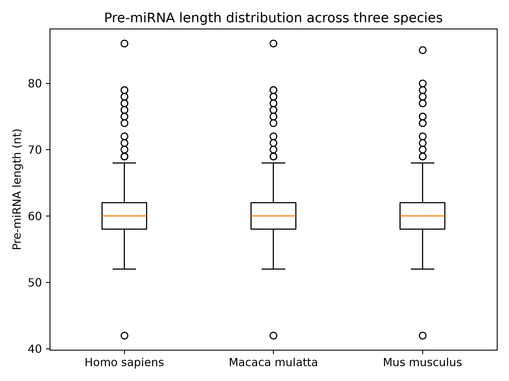

# Pre-miRNA Sequence Analysis

## About this project

This repository contains my initial work on analysing pre-miRNA sequences as part of my volunteer research project related to ncOrtho.

I'm using Python to explore sequence data, understand basic bioinformatics workflows, and practise using sequence alignment tools.

## 1. Pre-miRNA Length Analysis

I downloaded pre-miRNA FASTA files for three species from MirGeneDB:

- *Homo sapiens* (human)
- *Macaca mulatta* (rhesus macaque)
- *Mus musculus* (mouse)

I wrote a Python script to read the FASTA files and calculate the total number of sequences, minimum length, maximum length, and average length for each species.

### Results

| Species | Sequences | Minimum (nt) | Maximum (nt) | Average (nt) |
|---|---:|---:|---:|---:|
| Homo sapiens | 514 | 42 | 86 | 60.37 |
| Macaca mulatta | 497 | 42 | 86 | 60.48 |
| Mus musculus | 404 | 42 | 85 | 60.69 |

I also used Matplotlib to create a boxplot comparing the pre-miRNA length distributions across the three species.

The distributions appear quite similar, with average lengths around 60 nucleotides.

### Boxplot

## 2. DIAMOND — Sequence Alignment Practice

I installed DIAMOND v2.2.8 in GitHub Codespaces and explored its basic commands.

So far, I have:

- Created a small FASTA file containing three artificial protein sequences.
- Used `diamond makedb` to create a searchable protein database.
- Used `diamond blastp` to perform a protein similarity search.
- Generated a TSV file containing five reported alignments.
- Started learning how to interpret percentage identity, alignment length, E-values, and bit scores.

This was a practice exercise using protein sequences, separate from the pre-miRNA analysis.

## 3. Tools Used

- Python
- Matplotlib
- DIAMOND
- GitHub Codespaces
- MirGeneDB (pre-miRNA sequence data)

## 4. Current Status

The initial pre-miRNA length analysis and boxplot are complete. I have also completed a basic DIAMOND alignment exercise.

This repository is a work in progress and will be updated as I continue learning and working on the project.
